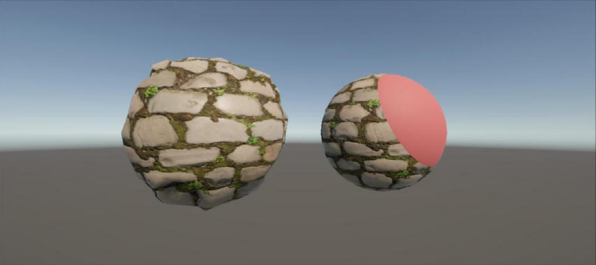

# はじめに
プログラムワークショップⅣの5つ目の管理用です

# 結果画像

- 工夫した点：Poly Haven の cobblestone_floor_04（Diffuse / Normal(GL) / ARM）を Shader Graph に組み込み、ARM の G（ラフネス）は One Minus で Smoothness に変換した。右の球（Shader Graph 2 MyShader）では、オブジェクト空間の中心 `Center` からの距離の2乗と `Radius Sq` を Step で比べて球の内外を判定し、内側だけを `Inside Color` の単色（平らな法線）に Lerp で切り替えた。中心・半径・色はマテリアルから調整できる。さらに左の球では、ディスプレイスメントマップを Sample Texture 2D LOD で頂点ステージから読み、`Scale` 倍してオブジェクト空間の法線方向に頂点を押し出して凹凸を出した。

# 進め方

- 本リポジトリをforkしてください
- fork先のリポジトリを更新してください
- Unityのプロジェクトをsrc内で進めてください
- 結果を画面キャプチャして、画像としてリポジトリに追加して、上記のリンクから見られるようにしてください
- 完成したら本リポジトリのmainブランチにpull requestを投げてください
